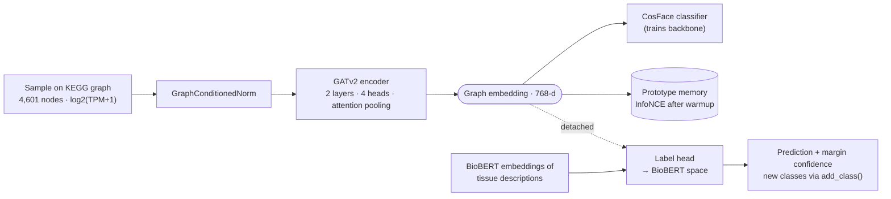
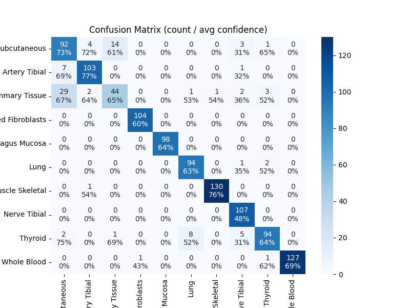
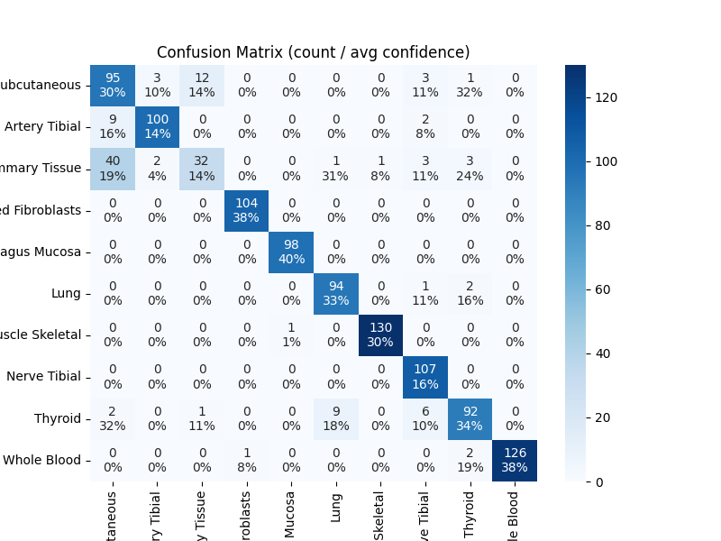
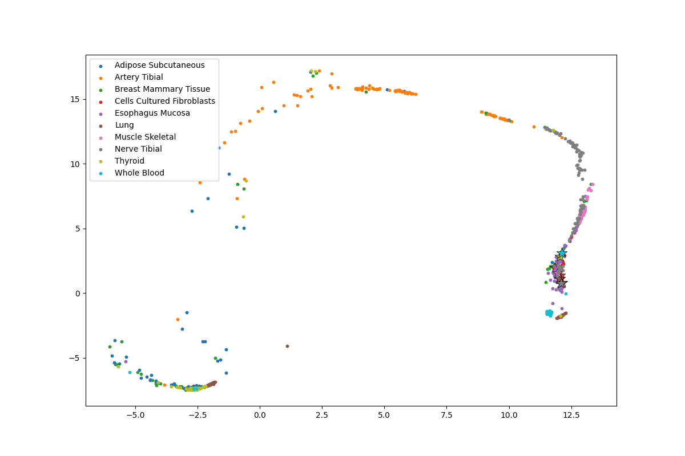
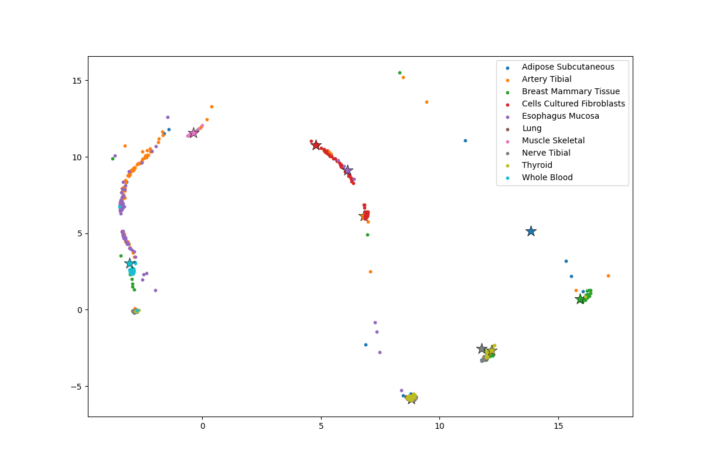
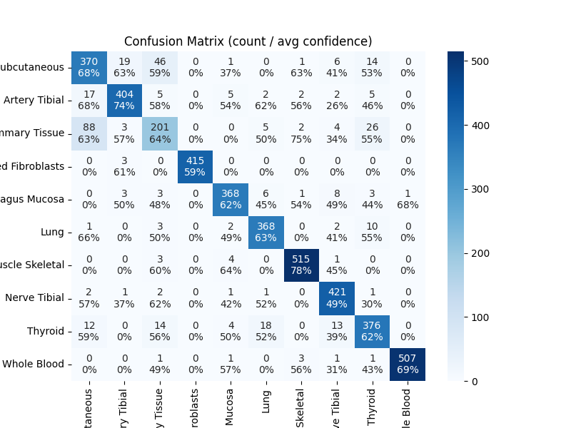
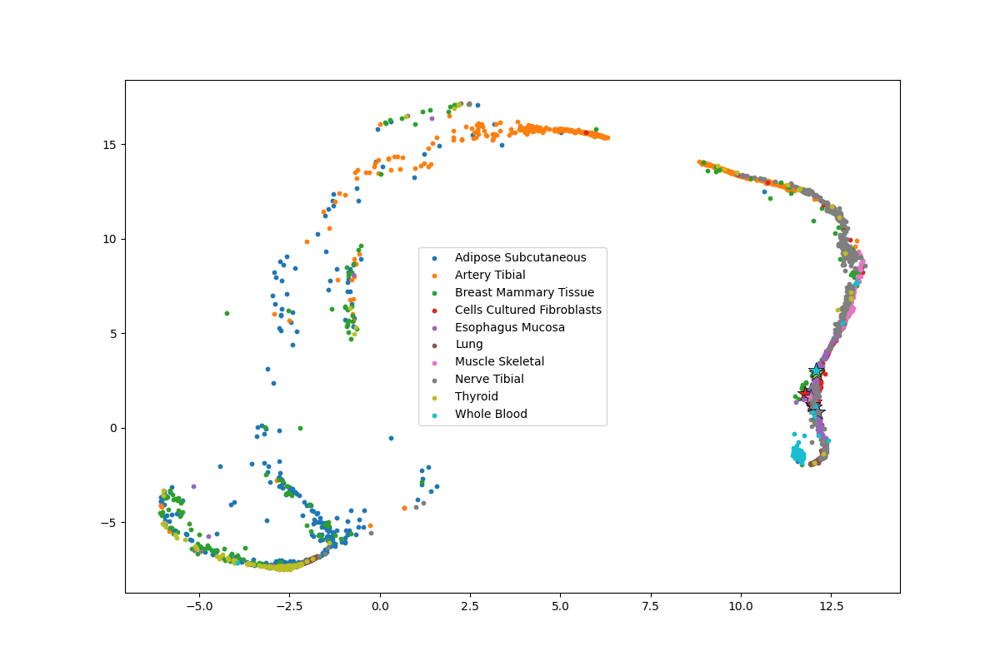
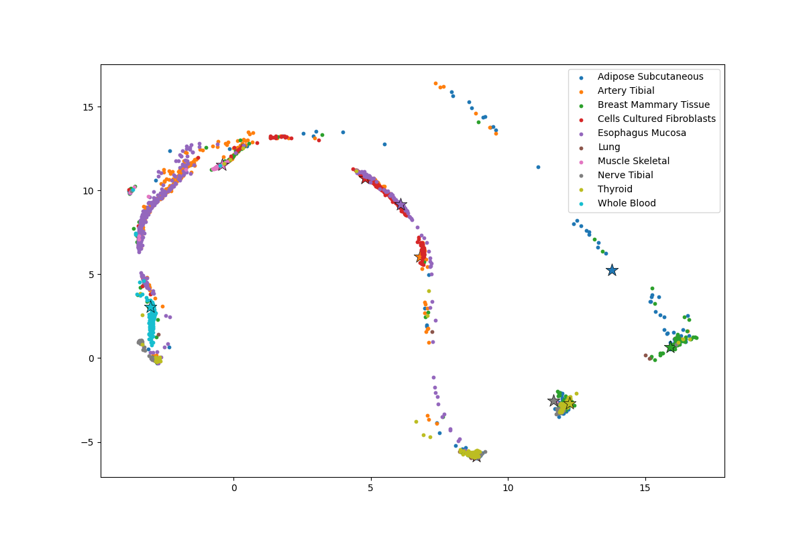
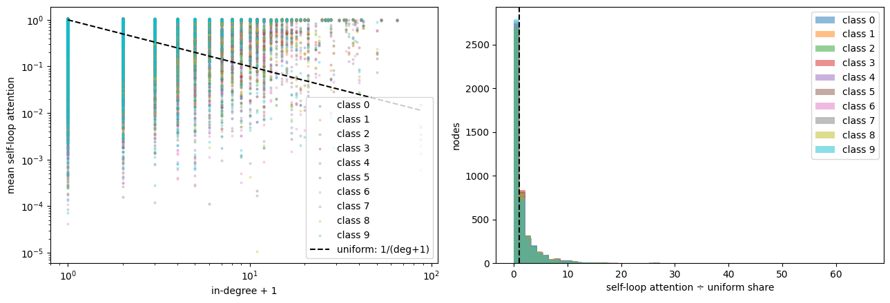
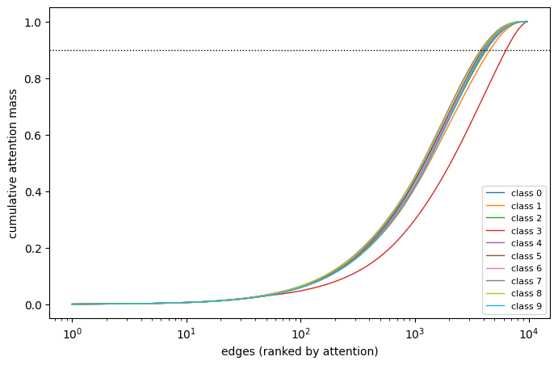

# GNN_POmics — Tissue Classification on Pathway Gene Graphs

[](https://colab.research.google.com/github/yoyo4581/GNN_POmics/blob/main/RefinedML.ipynb)

A graph attention network that classifies human tissue type from bulk RNA-seq, by reading each sample's
expression **on top of a KEGG gene-interaction network** rather than as a flat gene vector. The model pairs a
metric-learning classifier with a **BioBERT-anchored label head**, so new tissue types can be added from a text
description instead of retraining, and it keeps a **prototype memory** of class embeddings for contrastive training.

## Highlights

- **Biology-structured input** — every sample is the same 4,601-gene KEGG interaction graph; only the node
  features (log2(TPM+1) expression) change between samples.
- **GATv2 encoder with attention pooling** — node contributions to the graph embedding are weighted by the
  attention the second GAT layer assigns them, which makes the pooled embedding inspectable.
- **Two decoupled heads** — a CosFace (additive cosine margin) classifier trains the backbone; a separate head
  projects the (detached) embedding into BioBERT text space and classifies by cosine similarity to tissue
  descriptions.
- **Add classes without retraining** — `model.add_class(key, description)` embeds a new tissue's description with
  BioBERT and appends it to the label bank. The top-1 vs top-2 similarity margin acts as a confidence score.
- **Prototype memory + InfoNCE** — per-class replay buffers are agglomeratively clustered into prototypes, which
  serve as positives in an InfoNCE loss once warmup is complete.
- **Explainability built into training** — GraphMask edge masks, fidelity checks (top-k vs complement edges),
  per-class chord diagrams and intra/inter-class cosine-similarity tracking, all logged to Weights & Biases.

## Data

| | |
|---|---|
| Source | GTEx v10 bulk RNA-seq (normal tissue) |
| Samples | 6,764 from 945 donors |
| Classes | 10 tissues: Adipose (subcutaneous), Artery (tibial), Breast, Cultured fibroblasts, Esophagus (mucosa), Lung, Skeletal muscle, Tibial nerve, Thyroid, Whole blood |
| Graph | KEGG human pathway network: 4,601 gene nodes, 9,706 directed interaction edges, plus a gene→pathway index |
| Node features | log2(TPM + 1) expression, one value per gene |
| Split | Stratified 64 / 16 / 20 train / validation / test (`random_state=42`) |

Genes are mapped from GTEx (Ensembl / symbol) to KEGG `hsa:` Entrez IDs with `mygene`; the pathway graph itself is
exported from a local Neo4j knowledge graph (`Dataset/db_callers/GraphSnapshot.py`).

## Architecture



| Component | File |
|---|---|
| Full pipeline | [`Model/model3.py`](Model/model3.py) |
| Graph-conditioned normalisation | [`Model/layers3/normalize.py`](Model/layers3/normalize.py) |
| GATv2 encoder + attention pooling | [`Model/layers3/gat_encoder.py`](Model/layers3/gat_encoder.py) |
| CosFace loss | [`Model/layers3/CosFaceLoss.py`](Model/layers3/CosFaceLoss.py) |
| BioBERT label head | [`Model/layers3/label_encoder.py`](Model/layers3/label_encoder.py) |
| Prototype memory + InfoNCE | [`Model/layers3/proto_mem.py`](Model/layers3/proto_mem.py) |
| Training / evaluation loops | [`Model/trainer.py`](Model/trainer.py), [`Model/evaluater.py`](Model/evaluater.py) |

## Training

| Setting | Value |
|---|---|
| Optimiser | AdamW, weight decay 1e-5 |
| Learning rate | 5e-3 backbone, 1e-4 label head |
| Schedule | 25-epoch linear warmup, then cosine decay; a 5-epoch loss plateau triggers a warm restart at 0.85× the previous peak |
| GAT | hidden 64, 4 heads, dropout 0.1, 768-d output |
| CosFace margin | 0.35 |
| Batch size | 32 graphs (4,328 training graphs) |
| Epochs | 100 (Colab T4 GPU, ~26–34 s/epoch) |

Validation runs every 20 epochs; explainability plots are logged every 5. All metrics and plots are public on
W&B: [`GATModel3_100E_Fixed / fresh-leaf-1`](https://wandb.ai/pathwayoracle/GATModel3_100E_Fixed/runs/c1sn3hpk).

## Results

Validation set: 1,083 held-out samples across the 10 tissues.

| Head | Validation accuracy | Train accuracy |
|---|---|---|
| CosFace classifier | **91.7%** | 91.2% |
| BioBERT label head | **90.3%** | 89.7% |

The BioBERT head reaches nearly the same accuracy as the CosFace classifier, even though it classifies only by cosine
similarity to text embeddings of the tissue names and its gradients never reach the encoder.

| Epoch | 20 | 40 | 60 | 80 | 100 |
|---|---|---|---|---|---|
| CosFace val acc | 64.5% | 86.0% | 89.4% | 79.9% | 91.7% |
| BioBERT head val acc | 65.3% | 85.2% | 88.2% | 78.9% | 90.3% |

The dip at epoch 80 is a scheduled warm restart: the loss plateaued, so at epoch 78 the learning rate jumped from
5e-4 back to 4.25e-3, and accuracy recovered past its earlier level by epoch 100. Train and validation accuracy stay
within about a point of each other throughout, so there is no sign of overfitting at this stage.

### Confusion matrices (validation, epoch 100)

| CosFace classifier (91.7%) | BioBERT label head (90.3%) |
|---|---|
|  |  |

*Each cell shows the count and the mean prediction confidence.*

With the CosFace classifier, six of the ten tissues reach at least 95% recall, and cultured fibroblasts, esophagus
mucosa and tibial nerve are perfect. About half of all errors (43 of 90) are between **breast and adipose**: 29 of 82
breast samples are called adipose and 14 adipose samples are called breast. That fits the biology, since breast tissue
is largely adipose, and it leaves breast recall at 54%. The BioBERT head makes the same mistake more often (40 breast
samples called adipose, 39% breast recall). The next-largest confusion is thyroid predicted as lung (8 samples).

### Embedding space (validation, epoch 100)

| CosFace classifier embeddings | BioBERT label-space projection |
|---|---|
|  |  |

*UMAP coloured by true tissue; stars mark the BioBERT embedding of each tissue's name. The UMAP projection is fitted
once early in training and reused at every logged epoch, so these plots understate how well the final embeddings
separate the tissues.*

<details>
<summary>Training-set figures (epoch 100)</summary>



| CosFace classifier embeddings | BioBERT label-space projection |
|---|---|
|  |  |

</details>

## What the attention learned

After training, the notebook inspects the GATv2 edge attention of correctly classified training graphs, averaged
per tissue.

**Self-loops dominate.** GATv2 adds a self-loop to every node, so the 9,706 real edges become 14,174 attention
weights. 2,049 of the 4,601 genes have no incoming edge, so their self-loop is the only option, but the effect goes
further than that: for adipose tissue, 294 genes with five or more neighbours still put over 90% of their attention on
themselves, and only 48 connected genes spread attention roughly evenly. In practice the model mostly reads each
gene's own expression rather than passing messages along the pathway graph.



**Attention on real edges is diffuse.** For every tissue, the top 300 edges hold only 11–18% of the attention mass.
They touch roughly 430–460 genes split across about 150 disconnected pieces, and the largest piece covers only
10–15% of those genes. Cultured fibroblasts are the most spread out. So the current attention maps do not single out
a compact, tissue-specific pathway subnetwork.



### Incremental class learning (planned)

Next experiment: start with 5 tissues, then add 1, 3 and 1 more at successive validation checkpoints (via
`Trainer.sync_classes_from`), to test whether large or small increments disrupt the embedding space.

## Repository layout

```
RefinedML.ipynb        Main Colab notebook: training, evaluation and attention analysis
Model/                 Model3 pipeline (model3.py, layers3/), trainer/evaluator, schedulers, tissue_classes.json
Dataset/               Graph snapshot export, GTEx → graph dataset builder, Ensembl/Entrez lookups
visualization/         UMAP, confusion matrix, chord diagrams, attention and correlation plots
assets/                Figures used in this README
```

## Running it

The notebook is written for Google Colab with the project folder mounted from Google Drive
(`MyDrive/POGNN_Module`). It expects the prebuilt dataset in `Dataset/result/ML_Dataset/`
(`graph_structure.pt`, `{train,valid,test}_samples.pt`, `graph_snapshot.pkl`), which is not included in this
repository because of its size. Training logs to Weights & Biases; set a `wandb_key` Colab secret.

Rebuilding the graph from Neo4j instead of the pickle needs `NEO4J_PASSWORD` (and optionally `NEO4J_URI`,
`NEO4J_USER`) in the environment; the Entrez lookups read your NCBI contact address from `email`.

## License

See [LICENSE](LICENSE).
